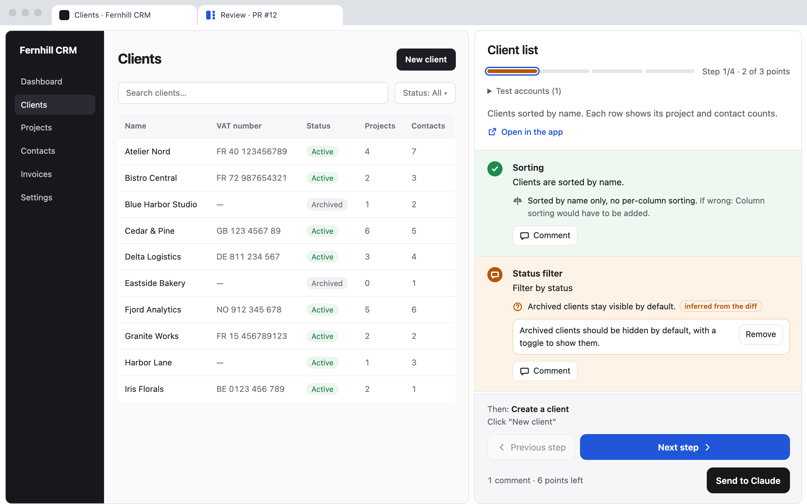

<p align="center"></p>

<h1 align="center">Review Walkthru</h1>

<p align="center">Walk through a pull request in your running app, then let Claude fix what you flag.</p>

<p align="center"><a href="https://review-walkthru.henry.pro">Website</a> · <a href="https://chromewebstore.google.com/detail/kjigknfmabifbopeelbckkilheemoedh">Chrome extension</a></p>



Review Walkthru is a Claude Code plugin. `/review-walkthru 123` starts the pull request's app on your machine and opens a review page beside it in Chrome. The page takes you through the change one step at a time: what the screen shows, which decisions the author made, which doubts Claude has, and what to test.

You check or comment on each point, then send the whole review to Claude in one click. Claude fixes in the conversation and offers a next round with only the steps to recheck. When a round passes without comments, Claude pushes its fixes, once you agree.

## Install

In Claude Code:

```
/plugin marketplace add Tilotiti/review-walkthru
/plugin install review-walkthru@review-walkthru
```

Then add the [Chrome extension](https://chromewebstore.google.com/detail/kjigknfmabifbopeelbckkilheemoedh). It opens your app next to the review page in split view, and loads the page's links in the app's half. It needs Chrome 155 or later. Without it, the page shows an "Open the app alongside" button and you arrange the split view yourself.

You also need:

- macOS or Linux (no Windows support yet);
- Node.js 18 or later;
- the GitHub CLI (`gh`), signed in with write access to the repo;
- Google Chrome.

`/review-walkthru` checks all of this at launch and lists what is missing.

## Use

```
/review-walkthru https://github.com/owner/repo/pull/123
/review-walkthru 123
/review-walkthru 123 --restart
```

Without an argument, it takes the last PR created in the session.

- The first time on a project, Claude asks how to start the app, which database to use and which data to create. It remembers your answers for next time.
- Each step splits into points: something to do or look at, with the decisions and doubts that go with it. Check a point to validate it, or comment on it. A point you neither check nor comment on comes back next round.
- "Send to Claude" works at any time, even in the middle of a round. The discussion happens in Claude Code.
- Claude pushes nothing without your go-ahead, and writes nothing on GitHub: no PR comment, no change to the description.
- `--restart` starts over from the PR head. Without it, the command resumes the review where it stopped.
- The page follows your browser's language: English or French.

## Your data

Everything stays on your machine, in `~/.claude/plugins/data/review-walkthru-review-walkthru/`:

- `runs/<owner>-<repo>-<n>/`: the scenario and review of each round, the test accounts and the PR worktree;
- `projects/<owner>-<repo>.json`: what Claude learned about starting the project.

The Chrome extension collects nothing. Details on the [privacy page](https://review-walkthru.henry.pro/privacy.html).

## Develop

```
npm test
claude --plugin-dir .
node scripts/dev-fixture.mjs /tmp/rw r1 && node scripts/relay.mjs /tmp/rw
```

The last line serves the review page on test data: open the address `dev-fixture.mjs` prints. To try the extension, load `extension/` unpacked from `chrome://extensions` with developer mode on. `npm run pack:extension` builds `dist/extension.zip` for the Chrome Web Store.

## License

[MIT](LICENSE)
