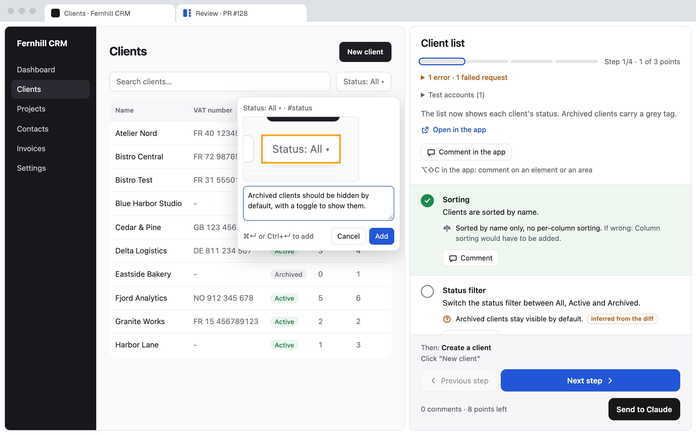

<p align="center">


</p>

<h1 align="center">Review Walkthru</h1>

<p align="center"><b>Don't merge what you haven't seen.</b><br>
A Claude Code plugin that turns a pull request into a real acceptance test: every screen, every decision Claude made, checked in your running app.</p>

<p align="center">
  <a href="https://github.com/Tilotiti/review-walkthru/actions/workflows/test.yml"></a>
  <a href="LICENSE"></a>
  
</p>

<p align="center">
  <a href="https://review-walkthru.henry.pro"><b>Website</b></a> ·
  <a href="https://review-walkthru.henry.pro/#try"><b>Try the live demo</b></a> ·
  <a href="https://chromewebstore.google.com/detail/kjigknfmabifbopeelbckkilheemoedh">Chrome extension</a>
</p>



## Why

Claude finishes a feature and hands you a long message: what to test, what it decided without you, what it left for later. You test from memory, switch between the chat and the browser, and send feedback one line at a time.

Review Walkthru removes the three things that make that painful:

- **You see everything that changed.** Claude writes a walkthrough that covers every visible change in the PR, screen by screen, in the order you use the app.
- **You see every decision.** Each decision and each doubt sits next to the screen that shows it, with what it would cost to change.
- **You stop going back and forth.** Your app and the review sit side by side in Chrome. Check each point, comment, and send everything back to Claude in one click. Claude fixes, then offers a next round with only what is left to check.

### From a real review

A 7-screen feature in a production SaaS:

| Round | What happened |
|---|---|
| 1 | 19 decisions and 7 doubts surfaced across 7 steps and 18 points. 4 comments sent back. |
| 2 | 1 comment left after Claude's fixes. |
| 3 | 2 of 7 steps to recheck. No comment. Pushed. |

## Install

**1. Add the plugin** in Claude Code:

```
/plugin marketplace add Tilotiti/review-walkthru
/plugin install review-walkthru@review-walkthru
```

**2. Add the [Chrome extension](https://chromewebstore.google.com/detail/kjigknfmabifbopeelbckkilheemoedh)** (pending Google review). It opens your app next to the review page in split view, and sends the page's links to the app's half. It needs Chrome 155 or later. Without it, the page shows an "Open the app alongside" button and you arrange the split view yourself.

**3. Review a pull request:**

```
/review-walkthru 123
```

You also need macOS or Linux, Node.js 18 or later, and the GitHub CLI (`gh`) signed in with write access to the repo. `/review-walkthru` checks all of this at launch and lists what is missing.

## How a review runs

1. **Run** `/review-walkthru <PR>`. Claude reads the PR, its commits and the conversation that built it. It starts the app, creates the test accounts, and writes the walkthrough.
2. **Walk through.** Chrome opens the review next to the app. Each step lists what to do, and the decisions and doubts behind it.
3. **Send.** Check a point to validate it, or comment on it. One click sends the whole review to Claude Code, mid-round if you want.
4. **Fix and repeat.** Claude fixes in the conversation and offers a next round with only the steps left to check. When a round passes with no comment, Claude pushes, after your yes.

The argument takes a PR URL or number: `/review-walkthru https://github.com/owner/repo/pull/123`, `/review-walkthru 123`. Without one, it takes the last PR created in the session. `--restart` starts over from the PR head; without it, the command resumes the review where it stopped. The review page follows your browser's language, English or French.

## Questions

<details>
<summary><b>Which apps does it work with?</b></summary>

Any web app you can run on your machine. The first time, Claude asks how to start it, which database to use and which data to create, then remembers your answers for that project.
</details>

<details>
<summary><b>Does Claude push without me?</b></summary>

No. Claude commits its fixes in a worktree and pushes only after you say yes in the conversation. It never comments on the PR and never edits its description.
</details>

<details>
<summary><b>Where does my data go?</b></summary>

Reviews stay on your machine, in `~/.claude/plugins/data/review-walkthru-review-walkthru/`: the walkthrough and review of each round, the test accounts and the PR worktree under `runs/`, and what Claude learned about starting each project under `projects/`. The Chrome extension collects nothing. The review you send goes to Claude Code, like any other prompt. Details on the [privacy page](https://review-walkthru.henry.pro/privacy.html).
</details>

<details>
<summary><b>What does the plugin run on my machine?</b></summary>

Node.js scripts from the plugin folder: a relay on `127.0.0.1`, behind a random token, that serves the review page and receives your review. The GitHub CLI (`gh`) to read the pull request. `git` to check the PR out in a worktree and, after your yes, push the fixes. The commands you agree on to start your app and create test data. Chrome, to open the review page. Nothing else: no telemetry, no other network call.
</details>

<details>
<summary><b>Does it run on Windows?</b></summary>

Not yet. macOS and Linux today.
</details>

## Develop

```
npm test
claude --plugin-dir .
node scripts/dev-fixture.mjs /tmp/rw r1 && node scripts/relay.mjs /tmp/rw
npm run build:site && python3 -m http.server -d dist/site 8123
```

The third line serves the review page on test data through the real relay: open the address `dev-fixture.mjs` prints. The last one serves the website and its live demo at `http://localhost:8123`. To try the extension, load `extension/` unpacked from `chrome://extensions` with developer mode on. `npm run pack:extension` builds `dist/extension.zip` for the Chrome Web Store, and `npm run assets` regenerates every marketing image (see [`marketing/`](marketing/README.md)).

## License

[MIT](LICENSE). Made by Thibault Henry.
